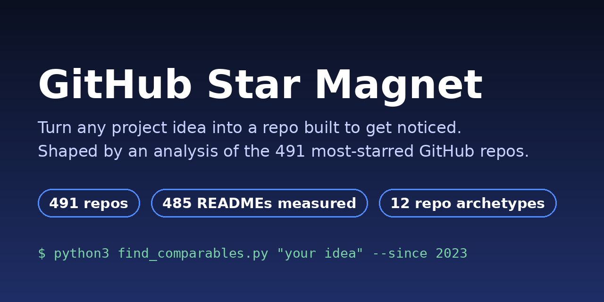
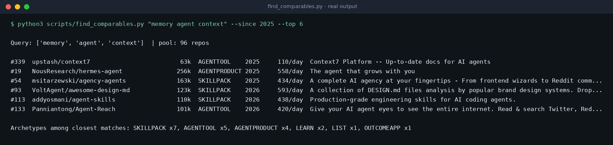
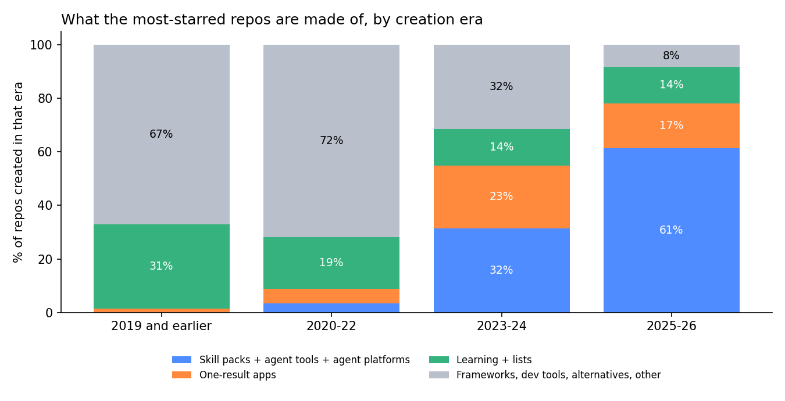
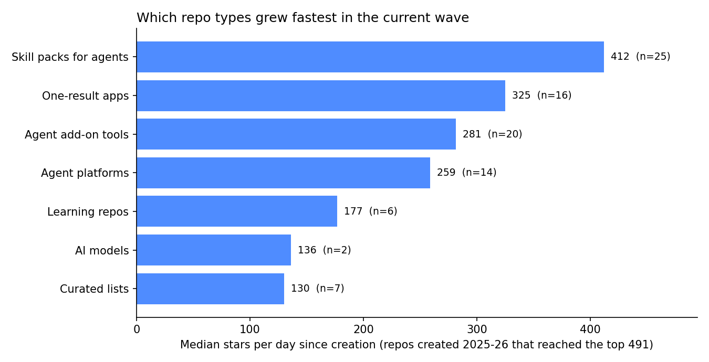

<div align="center">



# GitHub Star Magnet

**Turn any project idea into a repo built to earn stars, shaped by an analysis of the 491 most-starred GitHub repos.**

[](LICENSE)
[](https://github.com/udaydomadiya08/viral_repo_creator/actions)
[](https://github.com/udaydomadiya08/viral_repo_creator/stargazers)




[Install](#install-30-seconds) · [Quick start](#quick-start) · [Why](#why-this-exists) · [Findings](#what-the-data-says) · [Limits](#honest-limits) · [Contributing](#contributing)

</div>

**One-line install for Claude Code** (other options [below](#install-30-seconds)):

```bash
git clone https://github.com/udaydomadiya08/viral_repo_creator.git && cp -r viral_repo_creator/skill/github-star-magnet ~/.claude/skills/
```

---

## Why this exists

Many good side projects end with 3 stars. Usually the code is fine. The problem is the **shape** of the project: no sharp one-line promise, too many steps to try it, nothing to look at, no proof, and no plan to be seen.

Star Magnet is an AI skill plus a few small Python tools that:

1. finds the closest winners to **your** idea in a labelled dataset of the 491 most-starred repos,
2. picks a repo type that fits (12 types, e.g. agent skill pack, one-result app, curated list),
3. reshapes your idea into a sharper one and **scores it out of 20**,
4. builds the repo skeleton with a README in the structure the winners use, and
5. gives you a launch plan, or **audits a repo you already have**.

| | Blog posts and threads | Asking a chatbot with no data | **Star Magnet** |
|---|---|---|---|
| Based on measured data of 491 top repos | rarely | no | **yes** (all files included) |
| Reshapes *your* idea and scores it | no | sometimes | **yes** |
| Builds the repo skeleton and README | no | sometimes | **yes** |
| Audits an existing README against the data | no | no | **yes** (`audit_readme.py`) |
| Works without an AI (plain Python scripts) | n/a | no | **yes** |
| Guarantees stars | no | no | **no. Nobody can.** |

## Install (30 seconds)

Pick one.

**A. Claude app / claude.ai**: download [`dist/github-star-magnet.skill`](dist/github-star-magnet.skill) and upload it in Claude's skills settings (see Claude's help pages for the current menu path).

**B. Claude Code** (or any agent that reads `SKILL.md` folders):

```bash
git clone https://github.com/udaydomadiya08/viral_repo_creator.git
cp -r viral_repo_creator/skill/github-star-magnet ~/.claude/skills/
```

For other agents, copy the same folder into that agent's skills directory (check its docs).

**C. No AI at all**: the tools are plain Python 3.10+, with zero dependencies:

```bash
git clone https://github.com/udaydomadiya08/viral_repo_creator.git
cd viral_repo_creator/skill/github-star-magnet
python3 scripts/find_comparables.py "your idea keywords" --since 2023
```

## Quick start

With the skill installed, tell your AI agent something like:

> Use github-star-magnet. My idea: a tool that lists TODO comments in my codebase. Turn it into a repo that can get popular, then build it.

> Use github-star-magnet to audit `myname/myrepo` and tell me why it gets no stars.

> I don't know what to build. I'm good at Django and Docker. Use github-star-magnet to suggest 3 ideas with scores.

The skill will find comparables, choose an archetype, reshape and score the idea, write a **Repo Blueprint**, and (if you ask) scaffold and build the repo. See a full sample in [`examples/sample-blueprint.md`](examples/sample-blueprint.md).

The tools also work alone:

```bash
python3 scripts/find_comparables.py --archetypes                  # benchmark table of the 12 repo types
python3 scripts/find_comparables.py --list-archetype SKILLPACK --since 2025
python3 scripts/scaffold_repo.py --name my-tool --tagline "One sentence promise" \
        --archetype AGENTTOOL --author "Your Name" --user yourgithub --out ./my-tool
python3 scripts/audit_readme.py yourname/yourrepo                 # or a local README.md
```

## What the data says

Full numbers and limits: [`data-findings.md`](skill/github-star-magnet/references/data-findings.md). Highlights:



- **The top changed in 2025-26.** 20% of the 491 repos were created then, and 81% of their descriptions mention AI or agents. New frameworks and classic dev tools almost stopped entering the list.
- **Skill packs for coding agents grew fastest** (all 25 are from 2025-26), followed by one-result apps and agent add-on tools.



- **You do not always need a big codebase.** 15% of the top 491 have no real code (lists, guides), and 23% of the top 100.
- **Fast growers share a pattern** (repos created 2023+, fastest third vs slowest third): a "why this exists" section (52% vs 21%), a comparison with alternatives (55% vs 23%), a one-line install (82% vs 66%), a longer, skimmable README (about 2,460 vs 1,100 words).
- **Some things only look important** because they come *after* success: translations, star-history charts and sponsor links.

## How it works

1. **Intake**: your idea in 1-3 sentences (the skill asks at most two questions).
2. **Comparables**: `find_comparables.py` searches the labelled dataset for the nearest winners and their archetypes.
3. **Reshape + score**: 11 reshaping moves and a 10-criterion Star Score (0-20). Under 11 means "pick another idea".
4. **Blueprint**: name candidates, taglines, topics, MVP scope, one-command install design, proof plan, demo plan, odds and risks.
5. **Build + launch**: scaffold, write the smallest working version, run it, audit it, then a launch kit and a 4-week plan.

## Honest limits

- **Survivorship bias.** The dataset contains only winners. We cannot see the thousands of repos that did the same things and got 40 stars, so these are patterns, not proof of cause.
- **Distribution is invisible.** Author fame, launch timing, and luck are not in the data. A perfect README on a weak idea that nobody sees will still get few stars.
- **It is a snapshot** (2026-10-25). The AI-agent wave may fade or get crowded. Refresh the data with `scripts/refresh_dataset.py`.
- **Labels are human judgment.** Each repo was hand-labelled into one of 12 archetypes. Disagree? Open a *Data correction* issue.
- **No fake stars. Ever.** No buying, swapping, or bots. The skill refuses and suggests honest options. It also never invents benchmarks, quotes or install commands.

## Repo layout

```
skill/github-star-magnet/     the installable skill
  SKILL.md                    workflow the AI follows
  scripts/                    find_comparables, scaffold_repo, audit_readme, refresh_dataset
  references/                 findings, archetypes, README blueprint, launch playbook, dataset (CSV)
dist/github-star-magnet.skill ready-to-upload build of the skill
examples/                     a sample Repo Blueprint
tests/                        unit tests (run in CI)
docs/assets/                  images used in this README
```

Rebuild the `.skill` file after editing the skill: `bash build.sh`.

## Roadmap

- [x] 491-repo labelled dataset, README structure features, 12 archetypes
- [x] Comparables finder, scaffold, README audit, dataset refresh script
- [ ] Real screen-recorded demo GIF
- [ ] Quarterly dataset refreshes with a trend page
- [ ] Hindi, Chinese and Spanish versions of the guides
- [ ] GitHub Action that audits a README on every pull request
- [ ] Larger sample (top 2,000) to reduce small-group noise

## Contributing

Questions and ideas: [GitHub Discussions](https://github.com/udaydomadiya08/viral_repo_creator/discussions). Help is welcome and small contributions count: fix a wrong label, add a worked example, translate a guide, improve a script, or refresh the data. Start with [CONTRIBUTING.md](CONTRIBUTING.md). Run the tests with `python3 -m unittest discover -s tests`.

## Data notice

`references/top491_enriched.csv` is a snapshot of public repository metadata (name, star and fork counts, language, creation date, a shortened description) supplied by the project author on 2026-10-25, plus README **structure features computed by this project** (for example "has an image in the first screen"). README text is not redistributed. Archetype labels are this project's own judgments.

## License

MIT. See [LICENSE](LICENSE).
